# Elembi IPTV

A desktop player for your own IPTV subscription. It reads the channel, film and
series catalogue from an Xtream Codes panel and dresses it with TMDB's artwork,
summaries, cast and keywords.

**It ships no content.** There is no bundled playlist, no subscription and no
server behind it — what you can watch is decided entirely by the subscription
you enter. The interface is in Turkish.

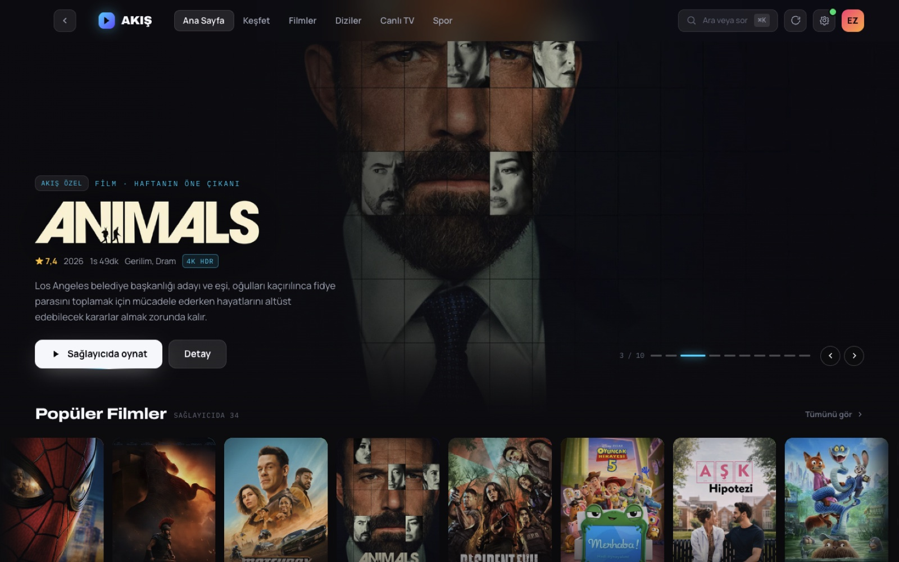

## Download

| | |
| --- | --- |
| **macOS** (Apple Silicon) | [elembi-mac-arm64.dmg](https://github.com/zavaremre/elembi-ip-tv/releases/latest/download/elembi-mac-arm64.dmg) |
| **macOS** (Intel) | [elembi-mac-x64.dmg](https://github.com/zavaremre/elembi-ip-tv/releases/latest/download/elembi-mac-x64.dmg) |
| **Windows** | [elembi-win-x64.exe](https://github.com/zavaremre/elembi-ip-tv/releases/latest/download/elembi-win-x64.exe) |
| **Linux** (AppImage) | [elembi-linux-x86_64.AppImage](https://github.com/zavaremre/elembi-ip-tv/releases/latest/download/elembi-linux-x86_64.AppImage) |
| **Linux** (Debian/Ubuntu) | [elembi-linux-amd64.deb](https://github.com/zavaremre/elembi-ip-tv/releases/latest/download/elembi-linux-amd64.deb) |

Every build is produced by GitHub Actions on that platform's own runner; see
[`.github/workflows/release.yml`](.github/workflows/release.yml). All releases
are listed [here](https://github.com/zavaremre/elembi-ip-tv/releases).

**The builds are not code-signed**, because signing needs an Apple Developer
account and a Windows certificate. Your system will say so, in its own words:

- **macOS** refuses to open it on a double-click. Right-click the app, choose
  **Open**, then **Open** again in the dialog. Once per install. If macOS calls
  it "damaged", the quarantine flag is the reason:
  `xattr -dr com.apple.quarantine "/Applications/Elembi IPTV.app"`
- **Windows** shows a SmartScreen warning. **More info** → **Run anyway**.
- **Linux**: mark the AppImage executable first — `chmod +x elembi-*.AppImage`.

**ffmpeg is required** and is not bundled; see below.

## What you need

| | |
| --- | --- |
| An Xtream Codes subscription | Any link the provider hands out: `get.php`, `player_api.php`, `xmltv.php`, or a stream address |
| A TMDB read token | Free. Without it the catalogue still works, but posters and summaries stay empty |
| **ffmpeg on your PATH** | Not optional — see below |

ffmpeg does the work Chromium cannot. Most providers ship films as Matroska, and
Chromium can neither seek accurately inside those nor decode AC-3 / E-AC-3 at
all — about 37% of this catalogue. Without ffmpeg you lose seeking, sound on
those titles, and the subtitles carried inside the file.

```bash
brew install ffmpeg      # macOS
winget install ffmpeg    # Windows
apt install ffmpeg       # Debian/Ubuntu
```

## Getting started

The first run asks for the subscription. One field: paste whatever address the
provider gave you. The username and password live inside that address, so you
are not asked for them separately — and when the link carries nothing itself,
the playlist behind it is opened and read (only the opening; the playlist for
the provider this was built against is 14 MB).

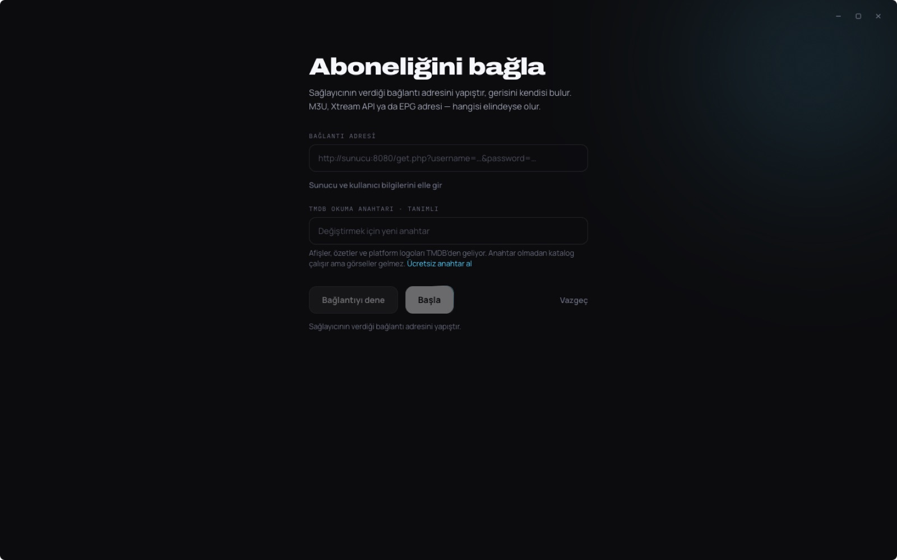

Nothing is saved until the panel has answered, so a subscription that cannot
connect never gets stored — and the reason it failed is more use here than on an
empty home screen.

## What it does

### The catalogue, grouped the way you think about it

The provider splits a single service across several categories — Netflix alone
arrives as five, counting its animation and German-language shelves. Cards are
grouped by the service they resolve to, so Netflix is one card with 900 titles.
Each card wears that service's own written logo, taken from the service's own
site; recognising which service a category belongs to still happens against
TMDB's list for your region and the provider's own channel icons.

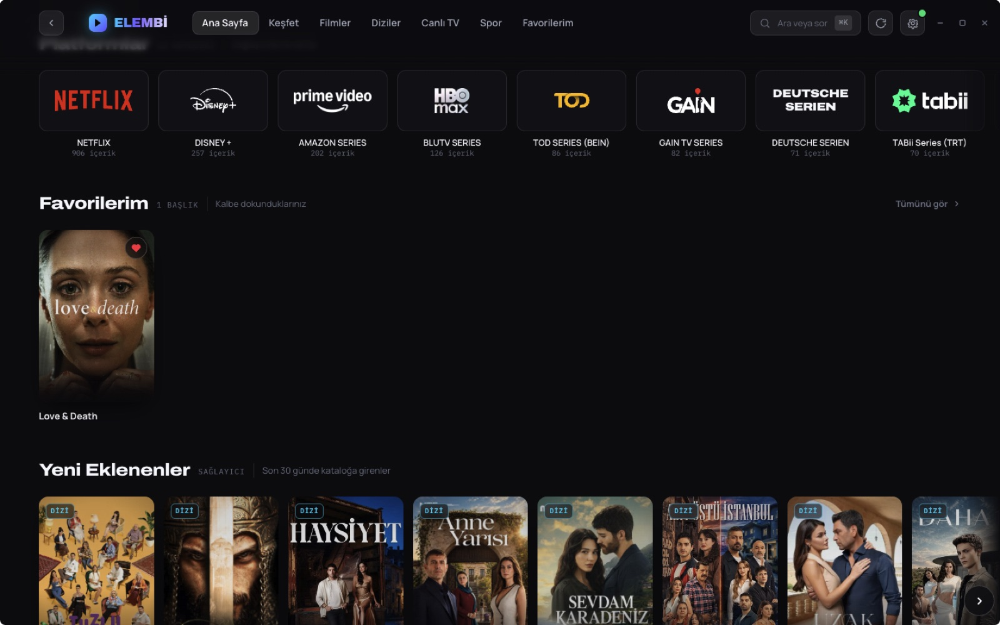

### Only what actually plays

Every TMDB rail, collection, genre list and related row is filtered to titles the
provider carries, so nothing on screen is a dead end. The catalogue is indexed
once per refresh — 11k entries into 18.5k keys in about 55 ms — because scanning
it per title would stall rendering. Discover keeps a toggle for seeing
everything.

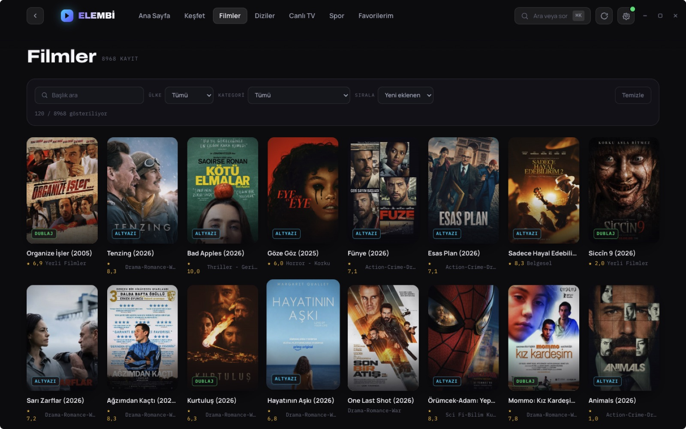

Country and category filters are derived from the catalogue rather than a table
of names: the provider's own prefixes only reached 61% of series, and reading the
rest from their category, their category's name and the catalogue's own make-up
takes that to 100% without inventing a code the data has never seen.

### What the subscription just gained

A row of what the provider added lately. TMDB's own release lists were tried
first and measured: of 46 titles in `now_playing` only 3 were in this catalogue,
and those were re-releases of a 2006 and a 2019 film. The provider's own
timestamp is both denser and the truthful answer to the question. Films and
series are drawn from each catalogue separately — a series' stamp moves with
every episode, so merging by date alone gave a row of 17 series and 3 films.

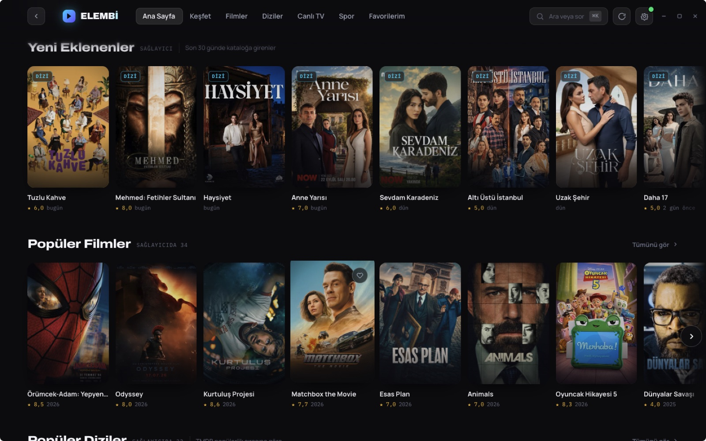

### Favourites

A heart on every card and every detail page. The list is stored next to your
settings and carries enough to draw the card on its own, so it stays whole when
the provider is unreachable.

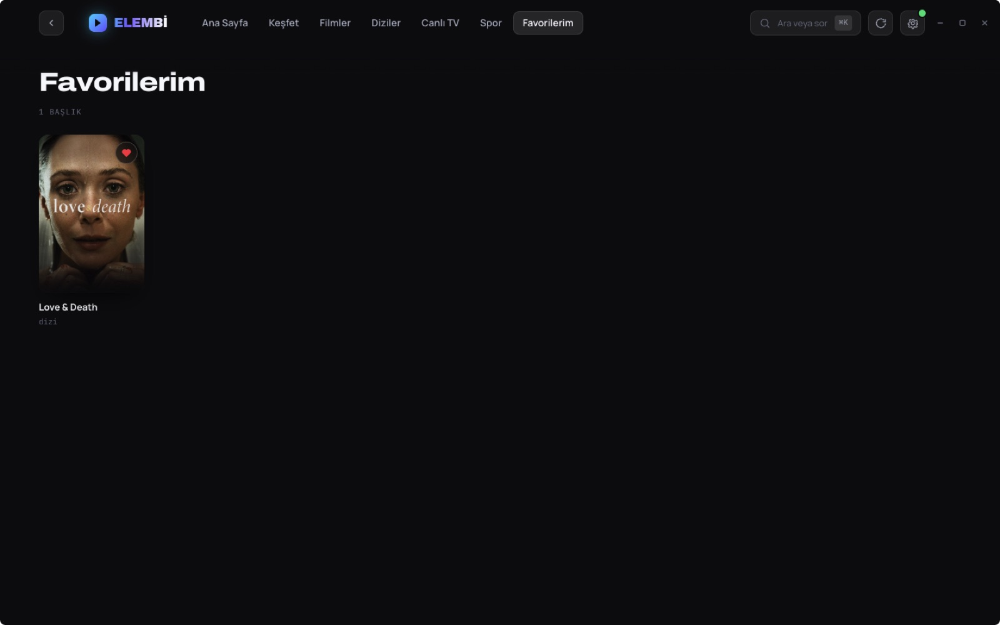

### Detail pages worth opening

TMDB credits, keywords that lead into a filtered search, alternative titles,
certification, trailer, and the season list merged with the episodes the provider
can actually play. A film's series is listed too — kept to the parts the provider
has, because naming a sequel that cannot be opened is worse than not mentioning
it. Clicking a cast member shows their own work; typing a name into search
offers the person rather than films with that word in the title.

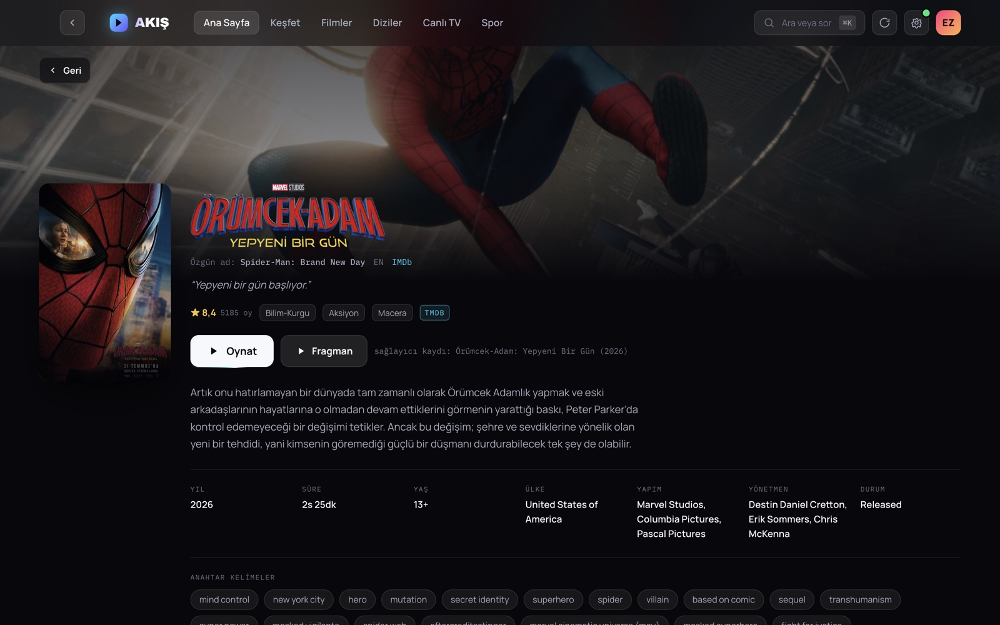

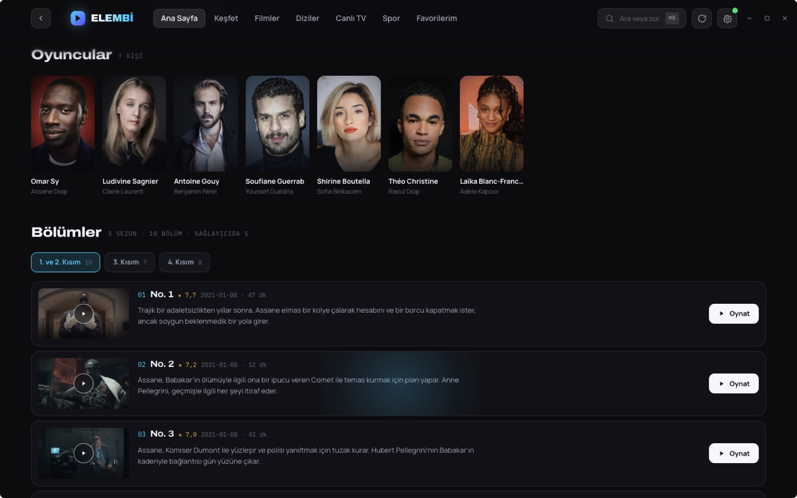

### Live TV and fixtures

736 channels with now/next from the provider's XMLTV guide, filtered by country
and category. Fixtures are pulled out of the sport channels' guide and tagged as
live, scheduled, tape-delayed or highlights. The day is shown under the kick-off
time because the guide reaches thirty hours ahead: a 01:25 match is three hours
away and still belongs to tomorrow.

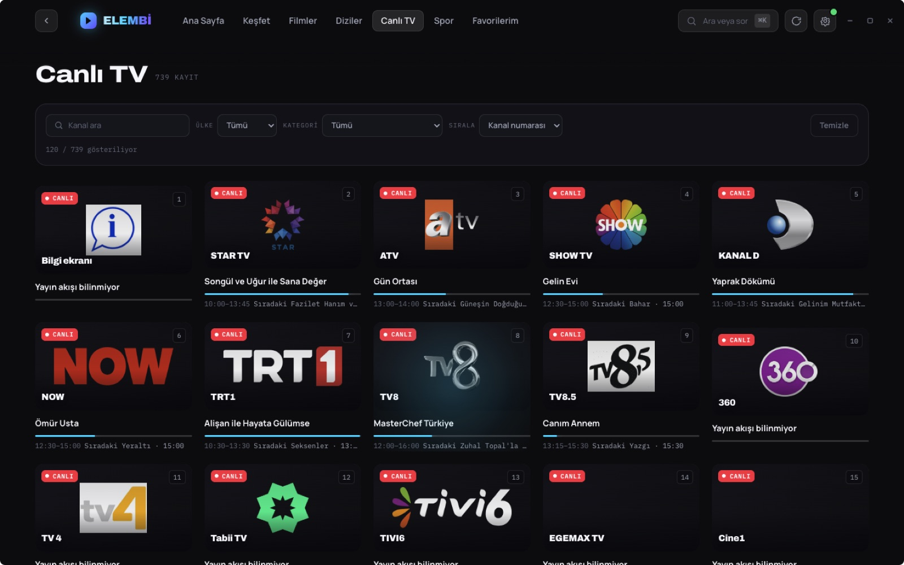

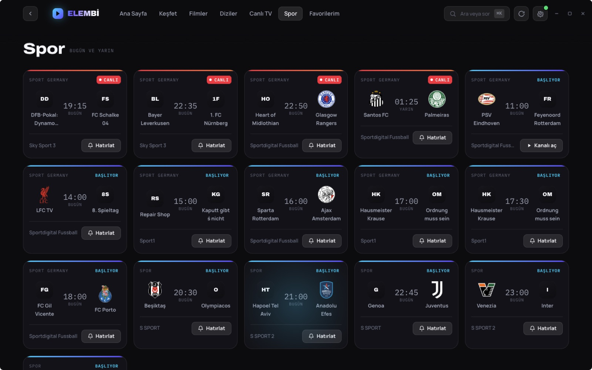

### Discover

Genre, keyword, year range, rating, vote count, language and sort order.
Keywords come from TMDB, so searching lands on subject matter rather than title
similarity.

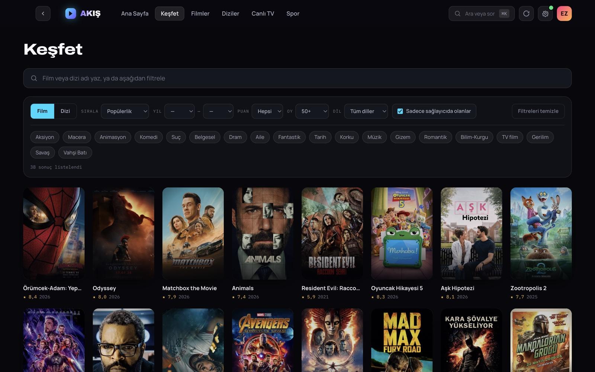

## How playback works

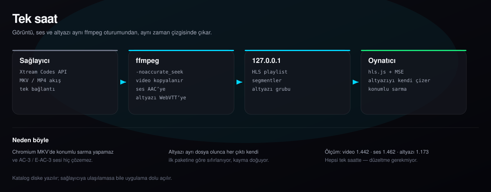

Picture, sound and subtitles leave one ffmpeg session on one timeline, and the
player is handed a local HLS playlist on `127.0.0.1`. That shape was arrived at
by measurement, not preference:

- **Seeking.** A Matroska file played directly never finishes a seek — Chromium
  hunts for an index that is not there. Through a local HLS playlist with real
  segment durations, a seek lands in 17 ms, exactly.
- **Sound.** AC-3 and E-AC-3 are silent in Chromium, so audio is re-encoded to
  AAC while the video is copied untouched.
- **Subtitles travel inside the stream.** They used to be written beside it, and
  that was wrong: ffmpeg normalises each output against its own first packet, and
  those differ. Seeking to 1800s put the video at 1795.192 and the first cue at
  1794.923, leaving the text a quarter-second out by an amount that changed with
  every seek. In one stream the player aligns subtitles the way it aligns audio.
- **Sound after a seek.** `-noaccurate_seek`, because without it audio is trimmed
  to the requested position while video falls back to the preceding keyframe —
  measured 6.187s of silence at the start of every seek, now 0.020s.

Subtitles carried inside the file are selected on their own when a Turkish track
is present and the audio is not already Turkish. They cannot drift, because they
shipped with the video.

## Being a good guest on someone's panel

The subscription has no request quota, but the panel locks an address out when it
sees too many requests in a minute — which cost several hours of access once.
Every request now passes a token bucket holding the sustained rate to
`XTREAM_MAX_PER_MINUTE` (60 by default) with a small burst for responsiveness,
gated by host so a new call site cannot slip past. Work nobody is waiting on
queues behind anything you clicked.

The catalogue is also kept on disk, so a restart costs the panel nothing and an
outage leaves the app full rather than empty. Refreshing marks it stale instead
of deleting it: the network is tried, a success overwrites, and a failure still
answers from the copy that was there.

## Privacy

There is no server behind this and no analytics of any kind. Everything lives in
your own user-data directory, and the app talks only to your provider, TMDB and
TheSportsDB. Two things are worth saying plainly: the Xtream protocol sends your
username and password in the address of every request, and TMDB learns which
titles you open. The full text is in the app under **Settings → Privacy**.

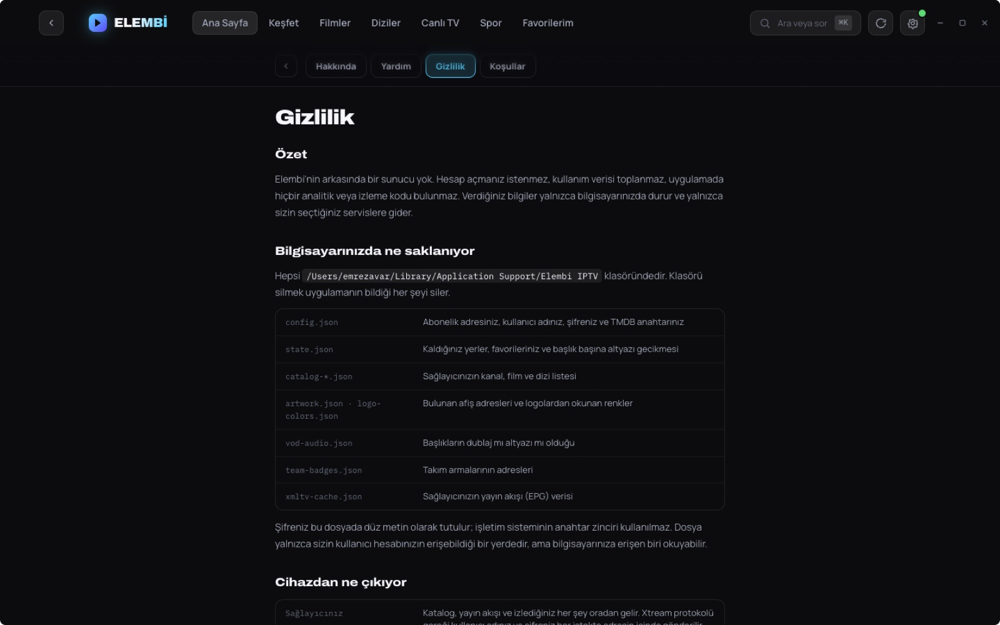

## Development

| Script | Does |
| --- | --- |
| `npm run dev` | electron-vite dev server and the app |
| `npm run build` | production bundle into `out/` |
| `npm run typecheck` | `tsc` over the node and web projects |
| `npm run pack` | an unpacked app in `dist/`, for trying the real bundle |
| `npm run dist` | installers for the current platform |

Credentials never reach the renderer bundle: every provider and TMDB request is
made in the main process and exposed over IPC through `src/preload`. Settings
live in `<userData>/config.json`, which takes precedence over a `.env` file if
you prefer to keep one.

Screenshots in this README are captured from the running app by
`src/main/devshots.ts`, which is inert unless `ELEMBI_SHOTS=1` is set:

```bash
ELEMBI_SHOTS=1 npm run dev
```

## Known limits

- **Built and used on macOS.** The Windows and Linux packages are produced by CI
  and have had less use.
- **Xtream Codes is required.** A provider that offers nothing but a flat M3U
  will give a channel list and no category structure, season lists or audio
  information.
- **Some panels filter by User-Agent.** The provider this was built against does
  not, but the pattern is common enough that a panel answering 404 to everything
  may be doing this.
- **The interface is Turkish**, as are the heuristics that read dub/subtitle
  markers and fixture tags out of a provider's own naming.

## Credits

This product uses the TMDB API but is not endorsed or certified by TMDB. Team
badges come from TheSportsDB.
